# GIANTPIZZA GRILL!!!

Final project concept · Jiesen Huang · submitted November 9, 2026

**How to read this page.** Section 1 lists the three ideas I came up with myself. Everything from Section 2 onward was developed in a question-and-answer session with an AI assistant and drafted with its help. All illustrations on this page are AI-generated sketches of a proposed design; nothing shown has been built or tested yet. The [AI disclosure](#ai-disclosure) at the end says who did what.

## 1. Initial idea notes (my own ideas)

These are the three ideas I started with. The ideas are mine; the wording below was prepared with AI help and keeps the content of my notes without adding to it.

1. **Meditation touchpad.** Five fingers rest on five capacitive pads. A computer screen acts as an ambient light. An Apple Watch heart-rate sensor (through a TestFlight app) or a purchased heart-rate sensor checks whether the person is really meditating.
2. **Pizza maker.** A screen shows the UI. A joystick is the mill, a pressed button rolls the dough, blowing into a microphone gives some kind of cue, and the VCNL4040 maps hand distance to oven heat. Several 3D-printed shells give each interaction its own body.
3. **Dance scorer.** A camera and a large TV. The system teaches a dance, the person imitates it, and a small vision model judges the moves.

## 2. Exploring the three ideas

I compared the ideas against four things the project has to survive: a classroom demo on December 7 where classmates walk up and try it for about a minute, a functional check-off in the week of December 1, at least two rounds of testing with real people, and the parts I already have.

### Meditation touchpad

The appeal is a calm, screen-light object that only needs a resting hand. Two things made me set it aside.

- **The measurement is not the thing I care about.** A falling heart rate does not show that someone is focused. Sitting still and daydreaming lowers it too.
- **The hardest part is outside this class.** Live Apple Watch heart rate needs a watchOS app distributed through TestFlight, which is a separate iOS project.

It also fits the demo badly. Meditation needs quiet and several minutes, and the room on December 7 will offer neither. A version without heart rate, where five finger pads follow a breathing rhythm for one minute, would be buildable, but it is a much smaller idea than the one I started with.

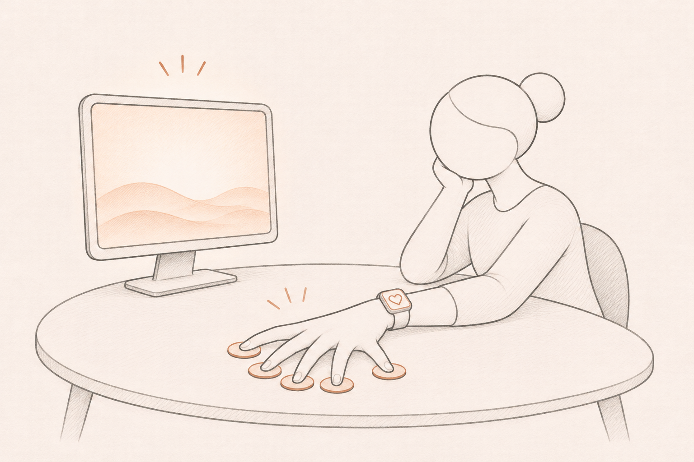

### Dance scorer

This would be the most fun to watch. The problem is that the device is a camera, a TV and a model, so nothing physical is designed and none of the sensing or prototyping from the labs is used. It is also technically tight on a Pi 5. In Lab 5 a YOLO model ran at 8–11 fps with the Pi at 75 °C, and scoring a dance adds the problem of lining up the dancer's timing with the reference.

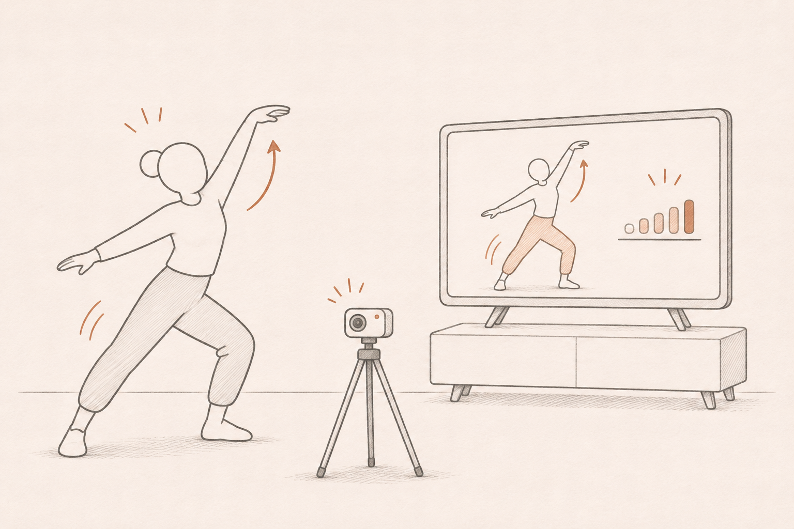

### Pizza maker

This is the idea I am taking forward.

- **Every step is a different physical action.** Circling a joystick, rolling, and holding a hand near heat are easy to tell apart and resemble what they stand for.
- **It works in a noisy room in about a minute.** Nothing depends on speech or on a long session.
- **It splits into steps that can be cut.** One step alone is still a complete loop.
- **The parts are already in the kit.**

Its weak points were the button for rolling dough, which is the least dough-like action of the four, and the lack of any goal. Section 3 addresses both.

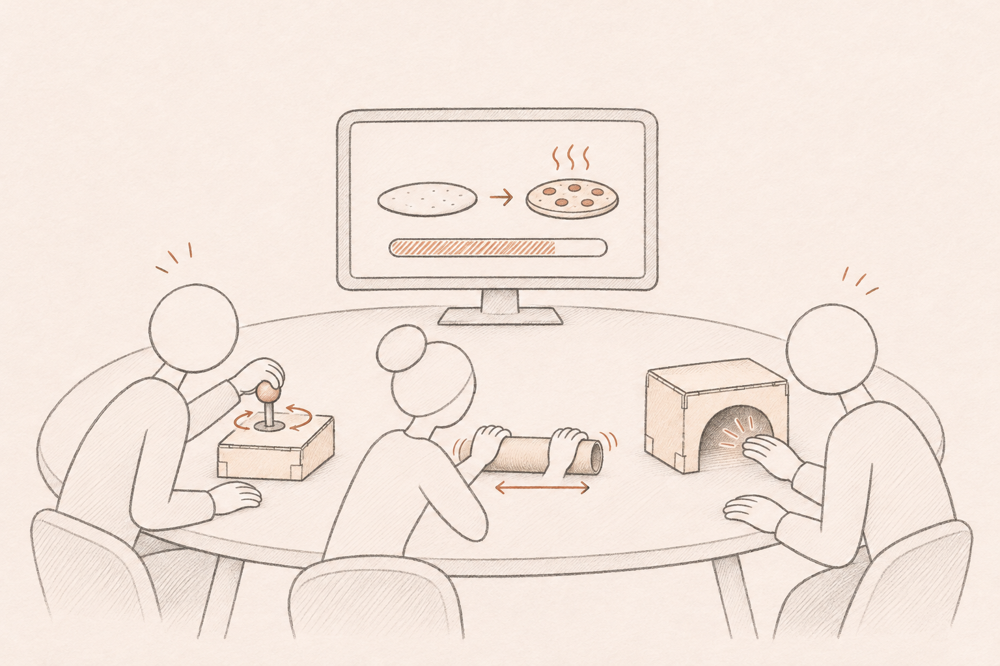

## 3. Big idea

GIANTPIZZA GRILL!!! is a tabletop party game where people make one pizza together at a row of physical stations. A shared screen shows an order card, such as a thin base baked dark, and the pizza as it takes shape. Each station is one job, done with one physical action:

| Station | Action | Sensor | Effect on the pizza |
| --- | --- | --- | --- |
| Mill | Circle the joystick like a hand mill | Qwiic joystick | Grinds the flour |
| Rolling pin | Roll a tube back and forth | LSM6DS3TR-C IMU inside the tube | Sets how thin the base is |
| Oven | Hold a hand at a distance from the oven mouth | VCNL4040 proximity | Sets how dark it bakes |

The stations run in order with overlap: the next one unlocks when the one before is about 70% done, so two people are usually active at once. A round lasts 60 to 90 seconds. At the end the pizza is compared with the order and scored in stars.

### Storyboard

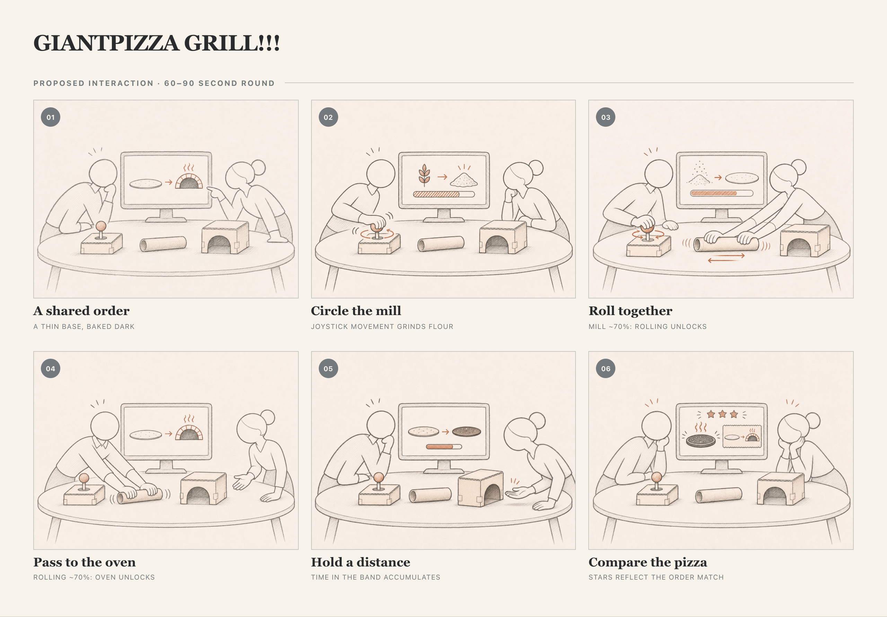

Source files: [storyboard HTML](storyboard-giantpizza.html) and [Verplank notes](storyboard-giantpizza.md).

**Who it is for.** Small groups at a table who want a short shared game, including classmates walking up at the final presentation with no explanation.

**Why these choices.**

- **An order gives the actions a target.** Without one, the game is only operating sensors in sequence. It also makes each replay different.
- **One shared screen keeps the group together.** In Lab 6 the shared display gave everyone the same place to look, and outside testers said that keeping the fire going together made it feel like telling the story together. Each Pi's small screen shows only its own station's progress.
- **The oven forgives shaky hands.** Lab 6 testers found it hard to hold a hand inside a narrow distance band. The oven band is about twice as wide, and it counts total time in the band, so drifting out does not reset progress.
- **Each station's shape shows what to do.** The screen highlights the active station with a short looping animation of the action, without written instructions.

### Station forms

Three cardboard forms were sketched for each station to compare before building. More are in [`assets/stations/`](assets/stations/).

| Mill | Rolling pin | Oven |
| --- | --- | --- |
| 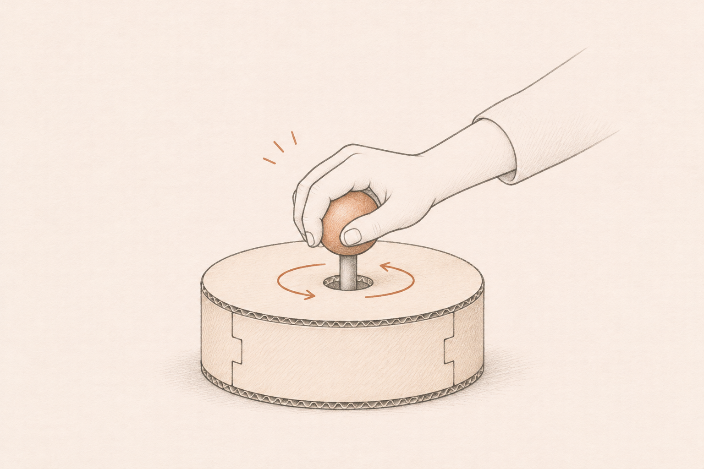 | 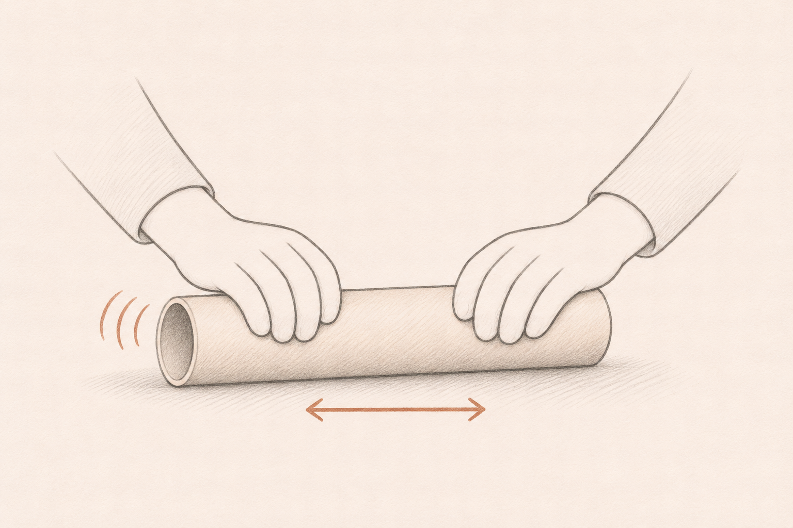 | 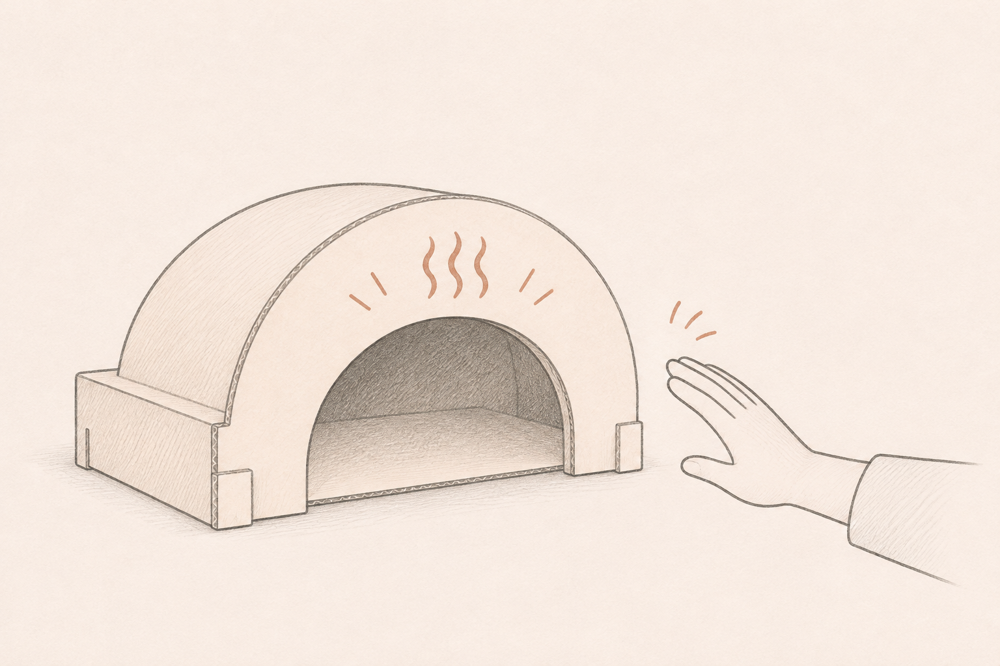 |
| 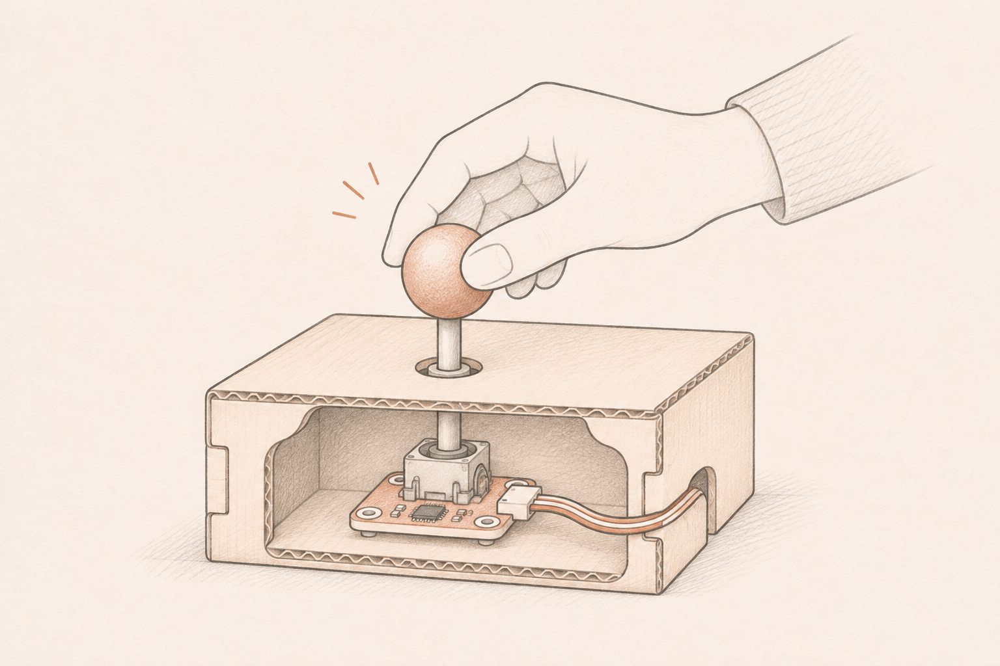 | No cutaway yet. How the IMU cable behaves while the tube rolls still needs a physical test. | 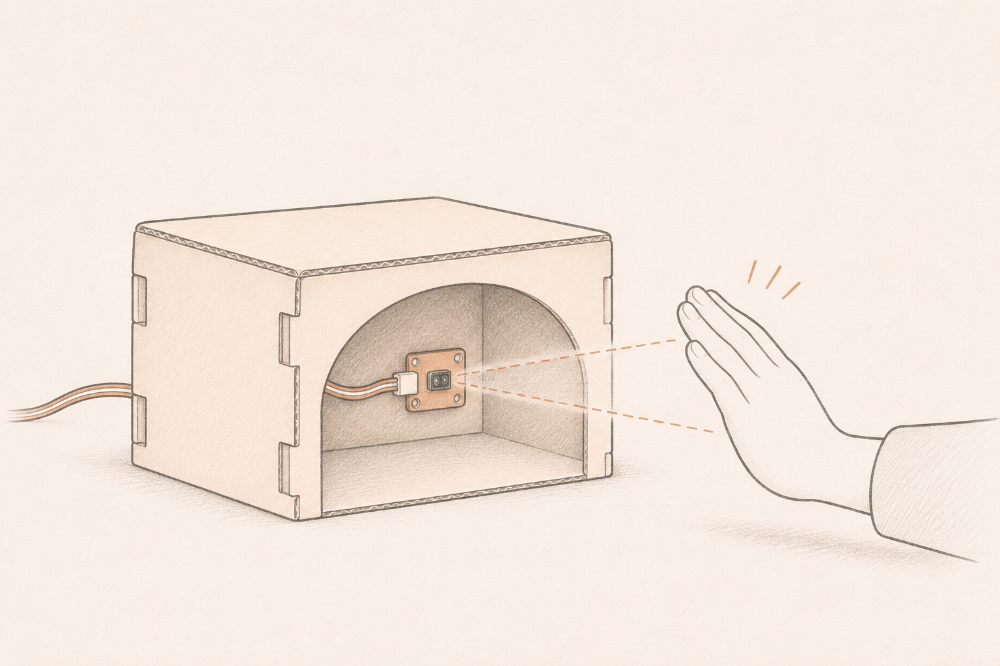 |

### Shared screen

Sketches of what the shared screen shows. More are in [`assets/screen/`](assets/screen/).

| Order card | Baking | Score |
| --- | --- | --- |
| 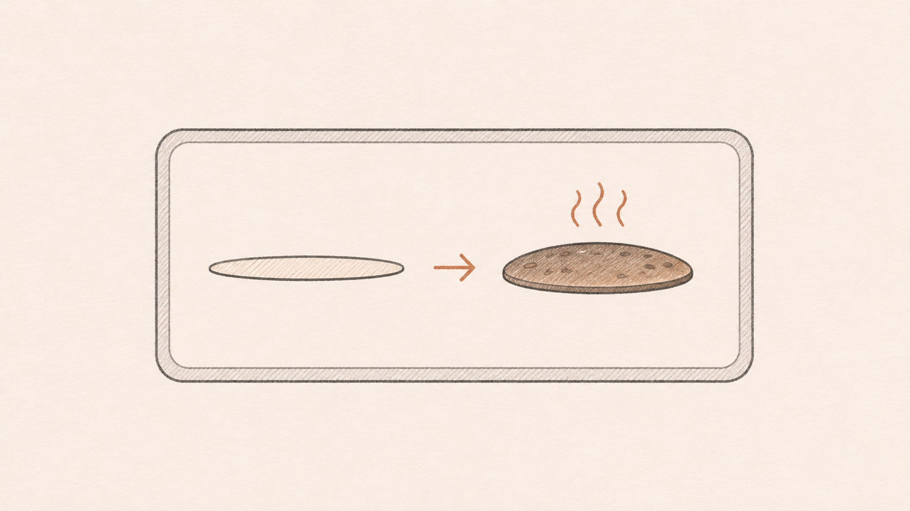 | 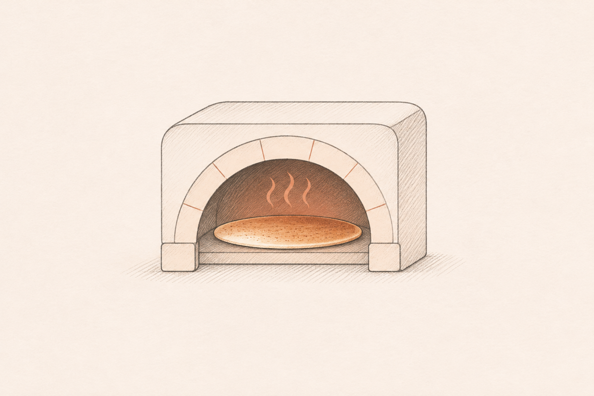 | 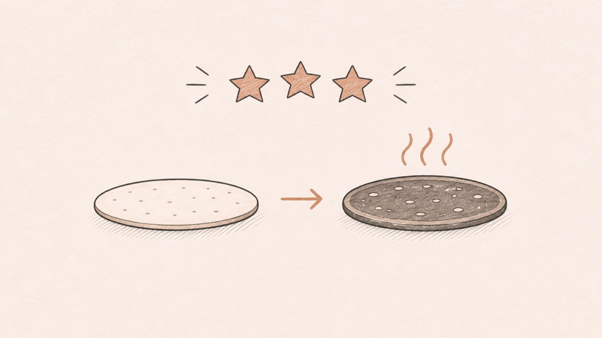 |

**Core loop for the functional check-off.** A physical action at one station changes the pizza on the shared screen, and the result is scored against the order. The oven station is the first to be built end to end.

**Architecture.** Each station reads its sensor on a Raspberry Pi and publishes a normalized value over MQTT. A laptop combines the readings, runs the game state and scoring, and draws the shared screen. This reuses the structure of our team's Lab 6 Digital Campfire. The concept is written for one Pi with all three sensors on a Qwiic chain, so it does not depend on team size. With teammates, each station moves to its own Pi.

## 4. Parts needed

Everything on the core loop is already in the course kit.

| Part | Use | Status |
| --- | --- | --- |
| Raspberry Pi 5 (Orange) | Reads sensors, publishes MQTT | Have |
| SparkFun Qwiic joystick | Mill | Tested in Lab 4 |
| SparkFun VCNL4040 proximity sensor | Oven | Tested in Lab 4 |
| Adafruit LSM6DS3TR-C IMU | Rolling pin | On the kit list, not yet tested |
| Qwiic buttons (red, green) | Start and reset, rolling-pin fallback | On the kit list, not yet tested |
| Mini PiTFT | Per-station progress | Used in Lab 2 |
| Laptop and a TV or monitor | Game state and shared screen | Have |
| Cardboard, tape, a cardboard tube | Station bodies and rolling pin | To collect |
| USB microphone | Stretch goal only | Tested in Lab 3 |

Optional purchase: one NeoPixel ring to glow inside the oven mouth. It is not on the core loop, so a late delivery does not affect the check-off.

## 5. Timeline

| Date | Milestone |
| --- | --- |
| Nov 11 | IMU confirmed in the kit and reading rolling motion. Team settled. |
| Nov 16 | Cardboard stations with a Wizard-of-Oz screen. First user test: can people tell what to do at each station without being told? |
| Nov 18 | Oven loop closed: sensor, MQTT, screen, score. |
| Nov 25 | Three stations chained into one round. |
| Week of Dec 1 | Functional check-off, followed by a second user test on the working system. |
| Dec 7 | Final presentation. |
| Dec 14 | Write-up and documentation. |

The screen uses simple shapes and colour changes until the check-off. Illustrated artwork and any 3D-printed station body come after it.

## 6. Fall-back plan

The design degrades in three levels. Each level is still a complete loop from action to score.

1. **Full version.** Three stations, several players, one shared screen.
2. **One player, three steps.** A single Pi with all three sensors, operated in sequence.
3. **Oven only.** One station with an order card and star scoring.

| Level 2: one player, three steps | Level 3: oven only |
| --- | --- |
| 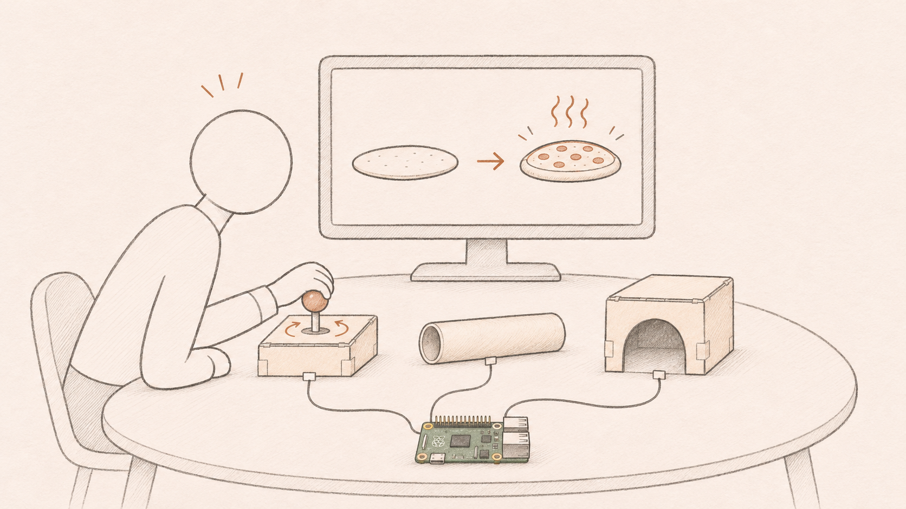 | 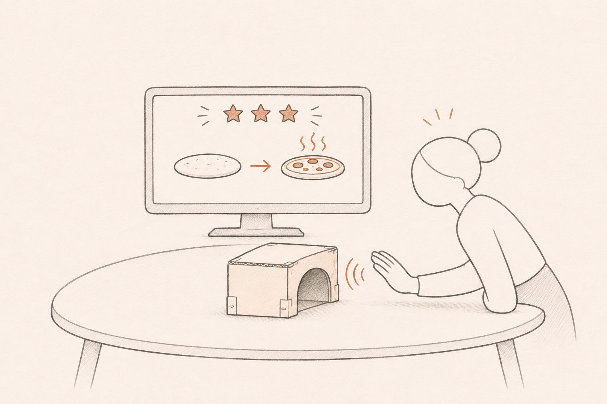 |

The wiring in the Level 2 sketch is schematic.

Fall-backs for single parts:

- **Rolling pin.** If the IMU is missing or unreliable by November 11, rolling becomes repeated presses of a Qwiic button.
- **Network.** If the course MQTT broker or classroom Wi-Fi is unreliable, the broker runs locally on the laptop.

**Stretch goal, outside the check-off.** A fourth station where blowing into a microphone cools the pizza, with a button as its fall-back, since a noisy room can trigger it by accident.

## AI disclosure

I used Claude (Claude Code) as a critic and a drafting tool. The ideas, the direction and the final calls are mine.

**What I decided.**

- **The three starting ideas.** I came up with the meditation touchpad, the pizza maker and the dance scorer, including the pizza maker's joystick mill, microphone and VCNL4040 oven.
- **How to use the AI.** I asked it to challenge my ideas with questions instead of generating ideas for me.
- **Which idea to build.** After weighing the objections to each idea, I chose the pizza maker and set the other two aside.
- **What to adopt.** I reviewed every suggestion listed below and chose to take it into the concept.
- **The name.** GIANTPIZZA GRILL!!! is mine.

**What the AI contributed.**

- **Critique.** Claude raised the heart-rate, demo-setting and Pi-performance problems recorded in Section 2 and recommended the pizza maker.
- **Design suggestions I adopted.** The IMU rolling pin in place of my button, the order card with star scoring, the overlapping station order, the wider cumulative oven band, the single-Pi baseline, the timeline and the fall-back levels.
- **Illustrations.** At my direction, OpenAI Codex generated the storyboard, station, shared-screen and context sketches with its image tool, following my repository's storyboard style. The prompts are saved beside the images. They show the proposed design and are not my hand sketches.
- **Writing.** Claude prepared the English wording of Section 1 from my notes without adding content, and drafted the rest of this document from our discussion.
