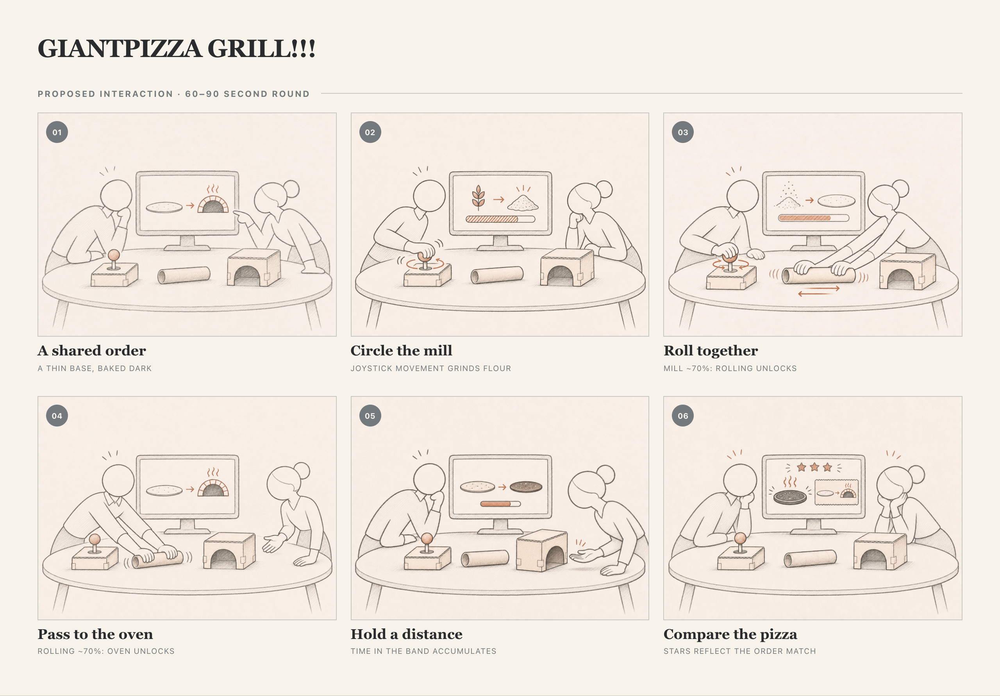

# GIANTPIZZA GRILL!!! — first storyboard

[HTML source and local preview](storyboard-giantpizza.html) · [Illustration prompts](assets/storyboard-giantpizza/prompts.md)

This is an ideation-stage proposal based on [sections 3–6 of the project concept](README.md#3-big-idea), not an observed session or a tested implementation. The drawings suggest cardboard forms and screen pictograms; neither is a finalized design. The thin, dark order is an example.

## Verplank breakdown

- **Idea:** Make a pizza together through distinct physical actions and compare it with a shared order.
- **Error:** Operating sensors alone lacks a shared target; a narrow hand-distance band was difficult for Lab 6 testers to hold. These are the motivations recorded in the concept, not findings from this project.
- **Metaphor:** A mill, rolling pin, and oven translate familiar pizza-making gestures into game inputs.
- **Scenario:** A small group gathers at a table for a short round, including classmates encountering the game without an explanation.
- **Model:** Stations proceed mill → rolling → oven; each next station unlocks at about 70% of the previous one, allowing overlap. The final pizza is compared with the order for stars.
- **Task:** Read the order, circle the joystick, roll the IMU tube, hold a hand at a distance from the oven mouth, and inspect the score together.
- **Display:** A shared screen shows the order, evolving pizza, and active-station action animation; each station's small screen shows its own progress. The sketches simplify these displays.
- **Control:** Joystick circles grind flour; rolling adjusts base thinness; hand distance controls bake darkness. The oven accumulates time in a wider band without resetting when a hand drifts out.

## To explore

Can new players recognize the intended actions without written instructions? Does the 70% overlap make the handoff legible and enjoyable? Can players understand how hand distance and accumulated time affect baking and the final score? The exact visuals, thresholds, and scoring details remain to be designed and tested. No hardware or user testing was performed for this storyboard.

Illustrations were generated individually with Imagegen; the sequence, captions, and layout were assembled with AI assistance from the existing concept.
