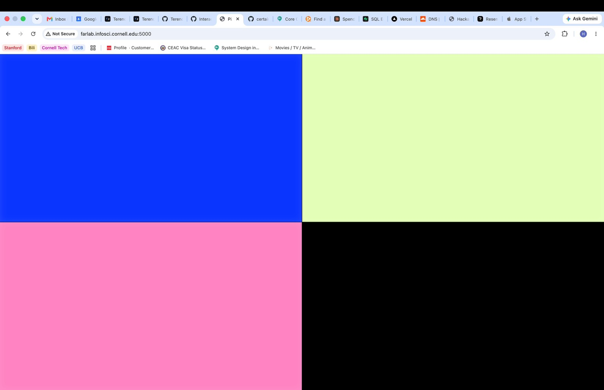
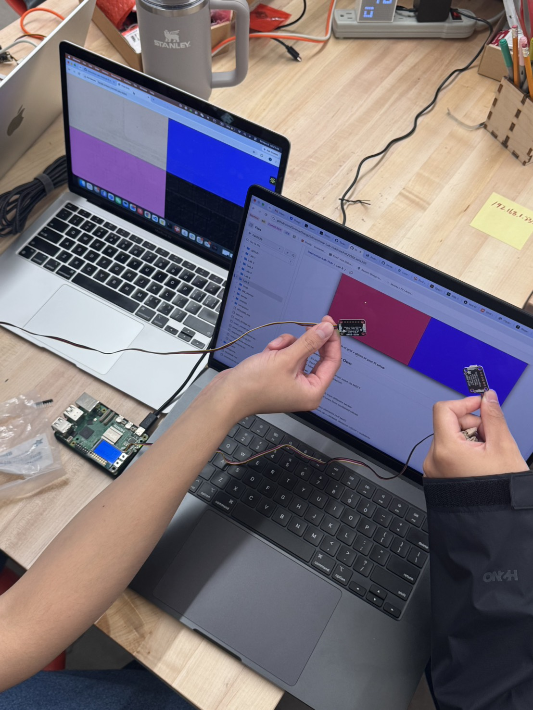
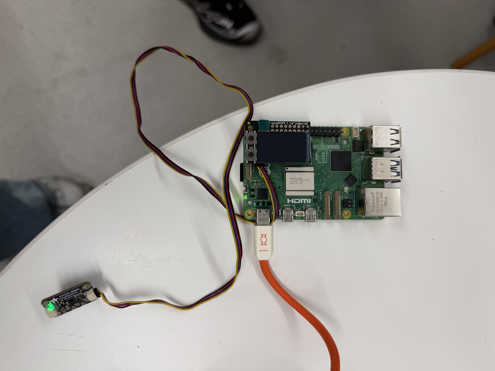
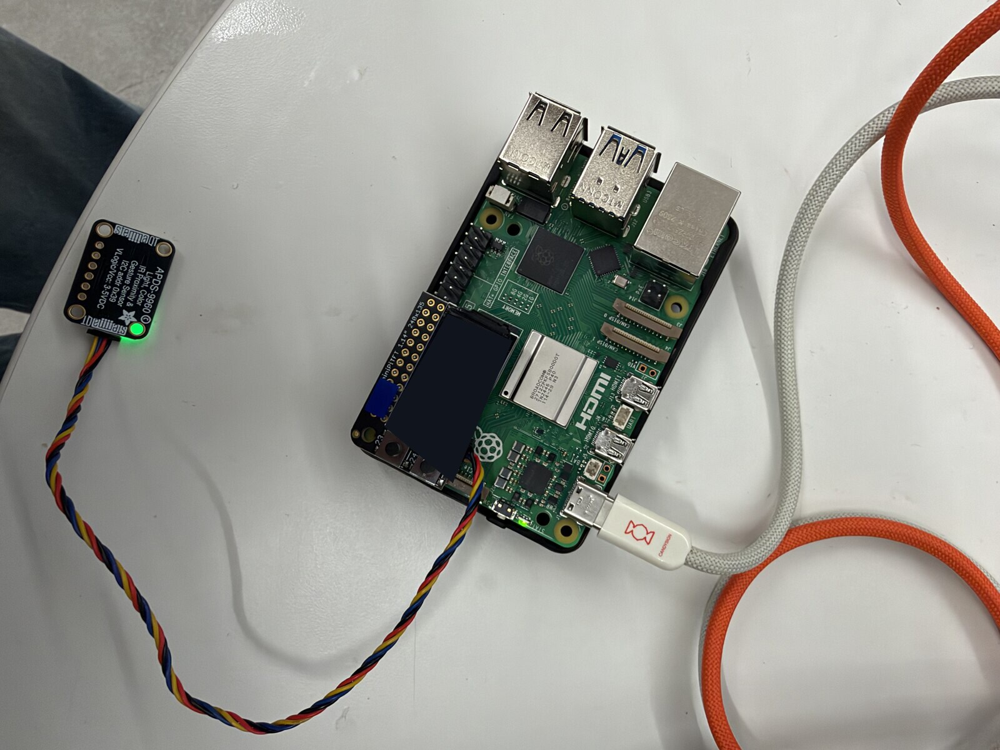
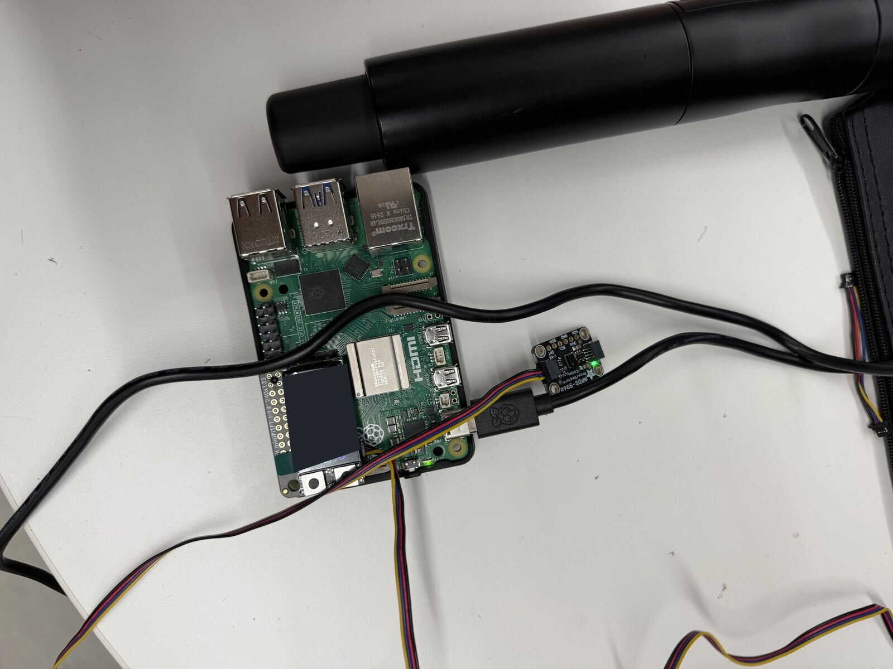
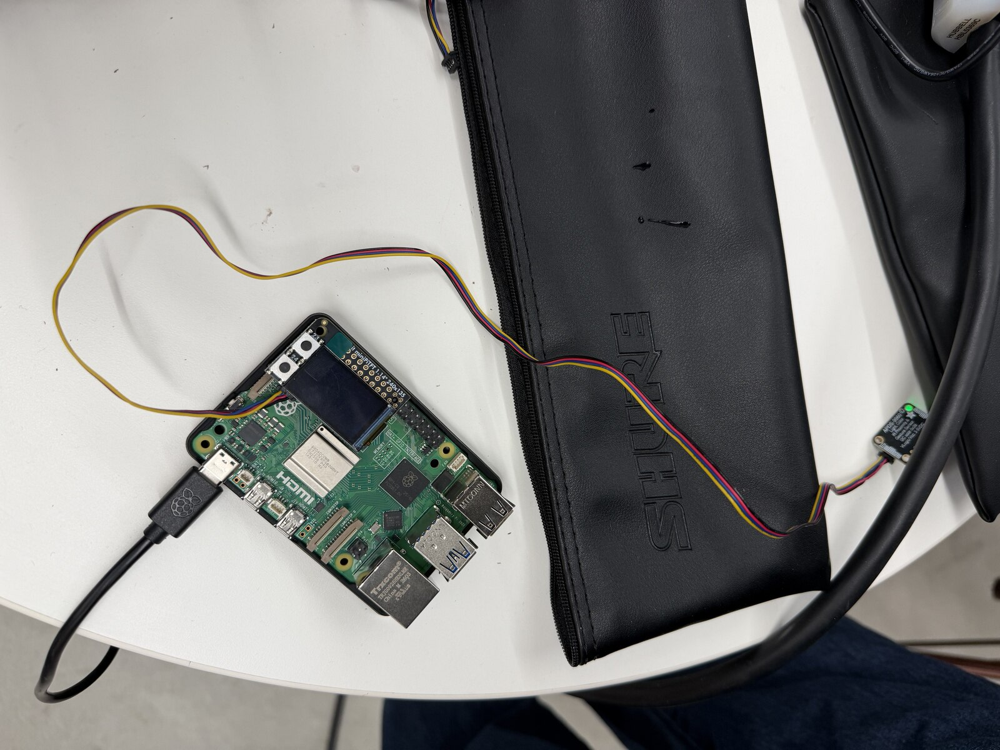
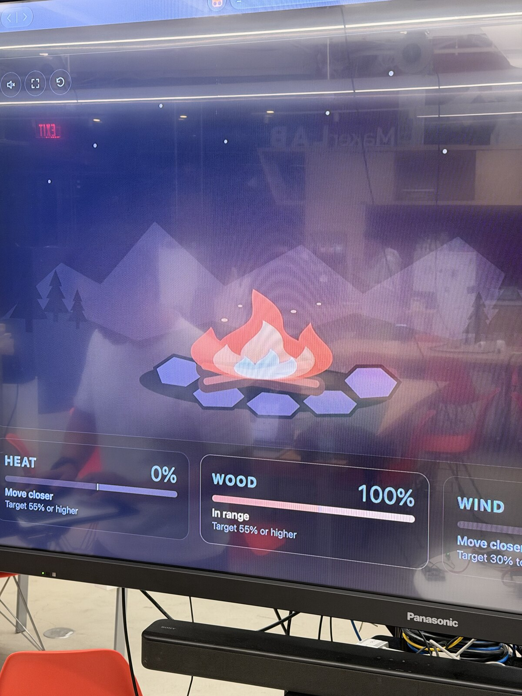

# Distributed Interaction

> Team progress and documentation are in blockquotes.

[Course instructions](https://github.com/IRL-CT/Interactive-Lab-Hub/blob/Fall2026/Lab%206/README.md)

## Part A: MQTT Messaging

> **Completed.** Orange and a teammate’s Pi each published a test message and received the other Pi’s message through the course MQTT broker.
>
> The team brainstorm covered five ideas: a creature whose senses are distributed across Pis, a shared campfire, a maze with split controls, a story that each Pi rewrites, and a rhythm game that responds when players synchronize. [Teammate’s Part A notes](https://github.com/ht534-ui/Interactive-Lab-Hub/blob/00e3eb18c5acbe4632c5d23da6edfc337f6d1f6d/Lab%206/README.md#brainstorm-five-ideas-for-messaging-between-devices)

## Part B: Collaborative Pixel Grid

> The team documented the browser pixel grid and the Raspberry Pi with its APDS-9960 sensor. Both images are from the [teammate’s Part B record](https://github.com/ht534-ui/Interactive-Lab-Hub/blob/00e3eb18c5acbe4632c5d23da6edfc337f6d1f6d/Lab%206/README.md#part-b-collaborative-pixel-grid).
>
> 
>
> 

## Part C: Make Your Own

> ### Digital Campfire
>
> Four players tend one virtual fire from separate Raspberry Pi stations. The heat and wood players keep their hands near their sensors while the wind player adjusts their distance to give the fire enough air. After the fire has stayed steady for three seconds, the storyteller moves a hand toward a fourth sensor to reveal the next line. The shared screen shows the flame, each station’s reading, and when the next line is ready. [Original team concept](https://github.com/ht534-ui/Interactive-Lab-Hub/blob/00e3eb18c5acbe4632c5d23da6edfc337f6d1f6d/Lab%206/README.md#deliverables)
>
> ### Architecture
>
> ```mermaid
> flowchart LR
>     heat["Heat · Pi + APDS-9960"]
>     wood["Wood · Pi + APDS-9960"]
>     wind["Wind · Pi + APDS-9960"]
>     story["Story · Pi + APDS-9960"]
>     broker["Course MQTT broker"]
>     server["Laptop · Flask fire and story state"]
>     screen["Shared browser · flame and story"]
>     heat --> broker
>     wood --> broker
>     wind --> broker
>     story --> broker
>     broker -->|"Normalized proximity readings"| server
>     server -->|"/api/state"| screen
> ```
>
> The Pis normalize their own sensor readings. The laptop combines all four inputs so the fire, timer, and story use the same state. The browser reads that state and draws the feedback.
>
> ### Build and run
>
> The prototype is in [`campfire/`](campfire/). Use separate virtual environments for this prototype and the Part B pixel grid. In a Bash shell on the laptop, run the following from `Lab 6/campfire`. Enter the course broker password when prompted.
>
> ```bash
> python3 -m venv .venv
> source .venv/bin/activate
> python -m pip install -r requirements-server.txt
> export MQTT_USERNAME=idd
> read -rsp 'Course MQTT password: ' MQTT_PASSWORD
> export MQTT_PASSWORD
> echo
> python app.py
> ```
>
> Open [the shared display](http://127.0.0.1:5000/) on the laptop. On each Pi, create a virtual environment in its copy of `campfire/`, install `requirements-pi.txt`, and set the same MQTT variables. Run one role per Pi.
>
> | Station | Command | MQTT topic |
> | --- | --- | --- |
> | Heat | `python publish.py heat` | `IDD/jiesen-lab6/campfire/heat` |
> | Wood | `python publish.py fuel` | `IDD/jiesen-lab6/campfire/fuel` |
> | Wind | `python publish.py wind` | `IDD/jiesen-lab6/campfire/wind` |
> | Story | `python publish.py story` | `IDD/jiesen-lab6/campfire/story` |
>
> [The publisher](campfire/publish.py) sends a reading such as `{"level": 0.62}` five times per second. Use `--show-raw` to check the range from a hand away to a hand close, then set `--low` and `--high` to those raw readings. Set `MQTT_PREFIX` to the same value on the laptop and all Pis if you need a separate session.
>
> [The server](campfire/app.py) marks a station offline after two seconds without a reading. Heat and wood must each reach 55%, and wind must stay between 30% and 70% for the fire to count as steady. The storyteller withdraws below 35% before approaching to at least 55%. This lets the same player reveal one line per gesture.
>
> ### Build photos
>
> Each station has its own Raspberry Pi and a wired APDS-9960 proximity sensor. The four photos below show the hardware used in the playthrough.
>
> | Station hardware 1 | Station hardware 2 |
> | --- | --- |
> |  |  |
> | **Station hardware 3** | **Station hardware 4** |
> |  |  |
>
> 
>
> The TV shows the fire and the live station readings together.
>
> ### Playthrough video
>
> [Download the Digital Campfire playthrough](assets/campfire/digital-campfire-demo.mp4). The opening shows a proximity sensor up close. Synchronized views then show the players and the shared display as they reveal all three story lines.
>
> ### Hardware check
>
> Four simulated publishers drove the shared display through a local MQTT broker. The test checked a fresh story gesture, a held hand, excess wind, and an offline station. In the hardware playthrough, all four Pis sent readings through the course broker at the same time, and the team unlocked all three story lines on the shared display. Testing with two people outside the team and the post-test reflection are pending.

## AI Disclosure

> OpenAI Codex helped configure and verify the MQTT test, summarize the team’s notes, implement and document the prototype, and edit the team’s photos and playthrough footage.
